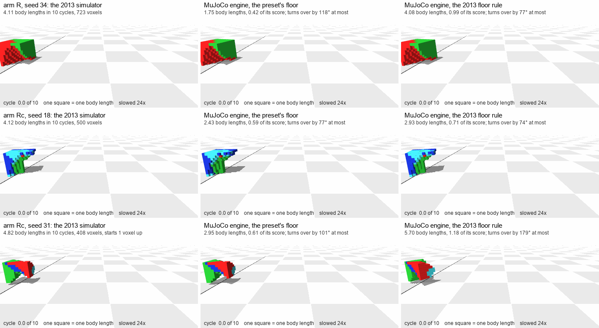

# Does the floor explain the transfer loss?

25 November 2026. Exploratory, in the sense of PROTOCOL.md, section 7: nothing here is an outcome of the protocol, and no setting of an arm is changed. The engine's code is not touched; the floors below are set up inside this folder's script, in its own processes.

## The question

The champions evolved in the 2013 simulator keep a median of 0.43 to 0.85 of their score in the MuJoCo engine ([outcomes](../outcomes/README.md), section "Transfer"). In the video they start alike and then tip over. In the 2013 simulator they stand most of a voxel deep in the floor; in the engine a tenth. Is the floor what costs them the gait?

## What the 2013 floor is, read from its source

`CVXS_Voxel::CalcFloorEffect` in the authors' archive (`Voxelyze/VXS_Voxel.cpp`), with the settings of the deposited robot files:

- **A spring on the centre of each voxel.** A voxel whose centre is lower than half its current size is pushed up with `E × size/2 × (size/2 − z)`. For the soft and the muscle material (E = 10 MPa, 1 mm) that is 5000 N/m per contact voxel, 25000 N/m for the stiff material. Plus damping on its vertical speed, `0.8 × 2 × m × sqrt(E × size / m)`.
- **Under load it is soft.** A voxel weighs 0.0275 N (1 g at 2.8 g). By this spring the median no-cost champion (650 voxels on 26 contact voxels) sinks about 0.14 of a voxel at rest and the median cost champion (363 voxels on 7) about 0.29. This project's engine got its hard floor in September on the model of the later Voxelyze library, whose spring is `2 × E × size`, four times stiffer, and on the weight of a single voxel, not of a whole body standing on a few voxels. How far a block sinks at rest on each floor is measured in the checks below.
- **Friction that stops a voxel dead.** A sliding contact voxel is braked with half its normal force. Once the brake would stop it within one time step (`0.5 × N × dt ≥ m × speed`), its horizontal momentum is set to zero and it is held in place, with all horizontal force on it cancelled, until the pull on it exceeds the full normal force. The deeper a voxel stands, the larger its normal force and the harder it is held. The threshold depends on the time step.
- The score is the three-dimensional distance of the centre of mass from where it started (`(GetCM() − IniCM).Length()`), as already found on 24 November.

## The floors compared

All with the MuJoCo engine and the settings of `--preset cheney2013` otherwise, one evaluation of 0.25 s per robot, bodies set on the floor.

| Name | What it is |
|---|---|
| `hard` | The preset's floor, as in the transfer outcome. Its scores must repeat that outcome exactly |
| `matched` | MuJoCo's own contact softened until a loaded contact voxel sinks as far at rest as on the 2013 floor: impedance 0.99, time constant 4.5 ms. In MuJoCo this softens friction too, so it is a crude stand-in |
| `default` | MuJoCo's default contact, the engine's `--floor-contact mujoco`: the soft floor this project used until September |
| `rule2013` | **The 2013 rule itself**, as read above: MuJoCo's contact switched off and the spring, its damping and the stop-dead friction applied to every voxel at each step, with the 2013 constants |

## Fixed before any champion is scored on these floors

1. **First the floors are checked on bodies that are not champions**: a block at rest, a block dropped from three voxels up, and the 12 pilot robots of generation 10, each also run in the recording copy of the 2013 simulator. `rule2013` goes on to the champions only if it settles a block where the 2013 simulator does.
2. **Robots.** The 140 champions of the transfer outcome: arms R and Rc and the deposited champions of both conditions.
3. **Measures**, per set of 35 and floor: the share of the score kept (median, bootstrapped 95% interval of the median), the rank agreement with the 2013 scores, and from the recorded motion: the lowest point reached (voxels below the surface), how far the body turns over at most (degrees), and the distance gained in cycles 6 to 10 over the distance gained in cycles 1 to 5 (near 1 for a gait that lasts, lower for one that breaks down). The same three from the 2013 simulator's own recording of each champion.
4. **What would support the explanation:** on `rule2013` the champions keep clearly more of their score than on `hard` (paired, per champion), turn over less, and rank more like they do in the 2013 simulator. **What would count against it:** no gain on `rule2013`. A gain on `matched` or `default` alone would say that softness helps without pinning down the rule; no gain on those two says little, since they soften friction as well.
5. Every number is reported, whatever it shows.
6. Added after the pilot robots below and before the champions: how many robots score within 20% of their 2013 score on each floor, and by how much the typical robot is off.
7. Added while the champions were being scored, before any of their results was read: the champions that do not touch the bottom of the workspace (16 of arm Rc, 12 of the deposited cost champions, 1 of arm R) are scored once more under `rule2013`, started at their height in the workspace, as the 2013 simulator starts them. For those sets that removes both known differences between the engine and the 2013 simulator at once.

## The checks, on bodies that are not champions

`python paper/diagnostics_2026-11-25/floor_softness.py --checks` (raw numbers in `floor_checks.json`). Height of the lowest voxel centres in voxels; 0.5 means standing on the surface without sinking.

| Body | | 2013 simulator | `hard` | `matched` | `default` | `rule2013` |
|---|---|---|---|---|---|---|
| Soft block 3×3×3 at rest (27 voxels on 9) | at the end | 0.4835 | 0.4998 | 0.4833 | −0.82 | 0.4835 |
| Soft tower 2×2×10 at rest (40 voxels on 4) | at the end | 0.4451 | 0.4996 | 0.4444 | −2.32 | 0.4451 |
| The block dropped from 3 voxels up | at its lowest | 0.371 | 0.433 | −0.161 | −2.89 | 0.360 |
| | at the end | 0.4835 | 0.4998 | 0.4833 | −0.82 | 0.4835 |
| A 4×4×4 block of the two muscle phases side by side, 10 cycles | distance moved, voxels | 0.31 | 6.20 | 0.82 | 1.87 | 0.12 |

- **`rule2013` puts a body where the 2013 simulator puts it**, to four digits at rest, and catches a dropped block about 0.01 of a voxel deeper than it. The condition of point 1 is met.
- **The resting depths are the ones the spring predicts**: 0.0165 of a voxel for the block (three voxel weights per contact voxel over 5000 N/m) and 0.055 for the tower.
- **The preset's floor does not let a body sink** (0.0002 and 0.0004 of a voxel).
- **MuJoCo's default contact is far too soft at these weights**: the block rests 1.3 voxels below the surface, the tower 2.8.
- **The muscle block is the clearest sign that the floor matters.** It has no reason to go anywhere and in the 2013 simulator it barely does (0.3 of a voxel in ten cycles). On the preset's floor it travels 6 voxels. Under the 2013 rule in the same engine it stays put (0.1).

## The pilot robots

`python paper/diagnostics_2026-11-25/floor_softness.py --pilot` (`floor_pilot.txt`, `floor_pilot.json`): the generation-10 champions of the 12-seed pilot of the original search program, which belong to no arm. In the 2013 simulator they score 1.71 in the median, stand 0.82 (quartiles 0.78–0.84) of a voxel deep at their lowest, and turn over by 56° at most.

| Floor | Share of the 2013 score, median (quartiles) | Off by, median | Within 20% | Rank agreement with the 2013 scores (95% interval) | Lowest point, voxels below the surface | Turns over by at most |
|---|---|---|---|---|---|---|
| `hard` | 0.97 (0.61–1.46) | 0.51 | 3 of 12 | +0.22 (−0.42 to +0.81) | 0.08 | 80° |
| `matched` | 1.13 (0.88–1.35) | 0.26 | 6 of 12 | +0.64 (+0.08 to +0.94) | 1.05 | 87° |
| `default` | 0.98 (0.64–1.23) | 0.30 | 3 of 12 | +0.27 (−0.41 to +0.81) | 2.98 | 74° |
| `rule2013` | 1.15 (0.98–1.22) | 0.18 | 7 of 12 | +0.76 (+0.23 to +0.98) | 0.80 (0.76–0.87) | 68° |

- On the preset's floor these robots are scattered around their 2013 scores: the median is right by chance, the typical robot is off by half, and the two simulators hardly agree on their order.
- Under the 2013 rule the engine agrees with the 2013 simulator far better: the typical robot is off by 18%, the order largely agrees, and the bodies sink as deep as they do in the 2013 simulator (0.80 against 0.82).
- Twelve robots; the intervals are wide. This is what the check was for: the rule goes on to the champions.

## The champions

`python paper/diagnostics_2026-11-25/floor_softness.py --champions --floors hard matched default rule2013 rule2013_placed` (`floor_champions.txt`, `floor_champions.json`). All 140 champions on every floor; no simulation blew up. On `hard` every score is the score of the transfer outcome, to the last digit, and in the 2013 simulator every champion repeats its known score.

**Under the 2013 floor rule the champions keep their score. The loss measured in the transfer outcome is the floor.**

Share of its 2013 score that a champion keeps in the engine, median (quartiles):

| Champions | `hard`, the preset | `matched` | `default` | `rule2013` | `rule2013`, started where it is | Gain of the last over `hard`, per champion (95% interval) | Better than on `hard` | p (Wilcoxon) |
|---|---|---|---|---|---|---|---|---|
| Arm R | 0.43 (0.33–0.75) | 0.51 | 0.49 | 1.02 (0.77–1.25) | 1.02 (0.77–1.27) | +0.41 (+0.26 to +0.64) | 29 of 35 | 0.000002 |
| Deposited 2013, no cost | 0.75 (0.51–0.91) | 0.54 | 0.57 | 1.16 (0.76–1.33) | the same | +0.37 (+0.13 to +0.46) | 28 of 35 | 0.00003 |
| Arm Rc | 0.67 (0.46–0.92) | 0.55 | 0.46 | 0.96 (0.72–1.27) | 1.07 (0.84–1.25) | +0.32 (+0.15 to +0.43) | 29 of 35 | 0.00001 |
| Deposited 2013, actuated cost | 0.85 (0.51–1.12) | 0.63 | 0.35 | 1.13 (0.82–1.33) | 1.15 (0.85–1.33) | +0.17 (+0.05 to +0.34) | 25 of 35 | 0.004 |
| All 140 | 0.65 (0.39–0.95) | 0.55 | 0.49 | 1.06 (0.75–1.29) | 1.08 (0.80–1.30) | | 111 of 140 | |

What the motion looks like, from the recordings (medians; "tip over" = the body turns by more than 90° at some moment):

| | In the 2013 simulator | `hard` | `matched` | `default` | `rule2013`, started where it is |
|---|---|---|---|---|---|
| Lowest point, voxels below the surface | 0.68 to 0.79 by set | 0.08 to 0.11 | 0.9 to 1.2 | 3.1 to 4.0 | 0.74 to 0.83 |
| Champions that tip over, of 140 | 5 | 67 | 87 | 97 | 52 |
| The body turns over by at most, by set | 49° to 62° | 84° to 92° | 94° to 115° | 109° to 147° | 69° to 81° |
| Distance in cycles 6–10 over cycles 1–5, by set | 1.25 to 1.28 | 0.64 to 1.11 | 0.61 to 0.85 | 0.44 to 0.83 | 0.94 to 1.15 |
| Rank agreement with the 2013 scores, by set | | +0.26, +0.33, −0.02, −0.07 | +0.02, +0.20, −0.03, −0.07 | +0.11, +0.32, 0.00, +0.37 | +0.36, +0.59, +0.61, +0.58 |

Read against what was fixed beforehand (point 4):

- **The explanation is supported on all three counts.** Under the 2013 rule the champions keep clearly more of their score than on the preset's floor, in every one of the four sets (111 of 140 do better); they tip over less; and they rank more like they do in the 2013 simulator.
- **It is the rule, not softness as such.** MuJoCo's own contact made as soft at rest as the 2013 spring (`matched`) and its default contact (`default`) do not help, and mostly hurt. On them the bodies sink deeper than in the 2013 simulator and tip over more.
- **Of the 48 champions that kept less than half on the preset's floor, 31 keep at least 0.8 under the rule.**
- **Starting a body where it is matters once the floor is right.** For the 16 champions of arm Rc that do not touch the bottom of the workspace, the median share is 0.68 on the preset's floor, 0.89 under the rule when set on the floor, and 1.07 under the rule when started at their height, and the arm's rank agreement rises from +0.34 to +0.61.
- **The earlier tendency for arm R's champions to keep less than the deposited ones is gone** under the rule (1.02 against 1.16, p = 0.50; cost condition 1.07 against 1.15, p = 0.78).

What it does not show:

- **The engine with the 2013 floor rule is still not the 2013 simulator, robot by robot.** The typical champion is off by about a quarter (median 0.22 to 0.29 by set), 49 of 140 are within 20%, and the rank agreement of about +0.4 to +0.6 is well short of the +0.9 that two builds of the 2013 simulator reach on the same robots.
- **The engine now tends to give more than the 2013 simulator**: the median share is above 1 in every set, by 2% to 16%, and 7 champions score more than one and a half times their 2013 score.
- **Tipping is reduced, not removed**: 52 of 140 still tip over under the rule, against 5 in the 2013 simulator. The second half of a run is about as fast as the first (0.94 to 1.15), where in the 2013 simulator it is a quarter faster (1.25 to 1.28).
- **This is an emulation written for a test**, outside the engine and checked on blocks and 12 pilot robots. Not checked: its sensitivity to the time step. The rule itself depends on the time step (a sliding voxel is stopped when the brake would stop it within one step), and the engine's step is 0.78 of the 2013 simulator's (`DtFrac` 0.7 against 0.9), so the two do not stop a voxel at quite the same speed.

## The same three champions as in the transfer video

`python paper/diagnostics_2026-11-25/render_floors.py` writes `../outcomes/videos/floors_champions.gif` (and `.webp`, `.png`, `.json`): the three robots that the transfer video's rule picked on 24 November, each in the 2013 simulator, in the engine on the preset's floor, and in the engine under the 2013 rule. The script stops unless all three panels hold the same body at the same height and the middle one repeats the score of the transfer report.

| Robot | 2013 simulator | Engine, the preset's floor | Engine, the 2013 floor rule |
|---|---|---|---|
| Arm R, seed 34 | 4.11; turns over by 50° at most | 1.75 (0.42); 118° | 4.08 (0.99); 77°. From the seventh cycle on it gains 0.49 to 0.56 per cycle, as in the 2013 simulator (0.47 to 0.48) |
| Arm Rc, seed 18 | 4.12; 59° | 2.43 (0.59); 77° | 2.93 (0.71); 74°. Still fades after three cycles |
| Arm Rc, seed 31, starts 1 voxel up | 4.82; 65° | 2.95 (0.61); 101° | 5.70 (1.18); rolls right over (179°) and gains more per cycle than in the 2013 simulator |

One robot restored, one helped a little, one that overshoots by rolling: the three show the spread behind the medians above. Under the rule all three stand as deep in the floor as in the 2013 simulator (0.83 to 0.86 of a voxel against 0.81 to 0.86).

## A lesson about memory

The first run of the champions used 14 worker processes. For a body of 800 voxels MuJoCo reserves 1.2 GB, and with arm A's 31 runs on the machine the system ran out of memory it could promise: 86 of the 140 evaluations under `rule2013` failed and were recorded as scores of zero. No run of arm A was harmed. The zeros stood out in the first summary and nothing was concluded from it. The scripts now take no more workers than the free memory allows and stop instead of recording a failure as a score, and the 86 were run again.

## Files

| File | Purpose |
|---|---|
| `floor_softness.py` | The floors, the checks, the scoring and the report |
| `render_floors.py` | The three-way video |
| `floor_checks.json` | The simple bodies: every number of the table above |
| `floor_pilot.txt`, `floor_pilot.json` | The pilot robots on the four floors |
| `floor_champions.txt`, `floor_champions.json` | The 140 champions on the five floors, with every robot |
