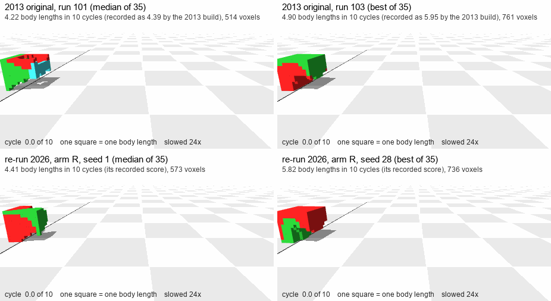
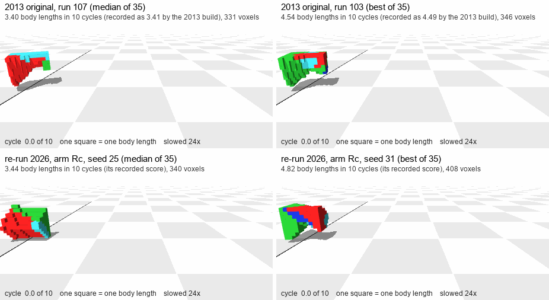
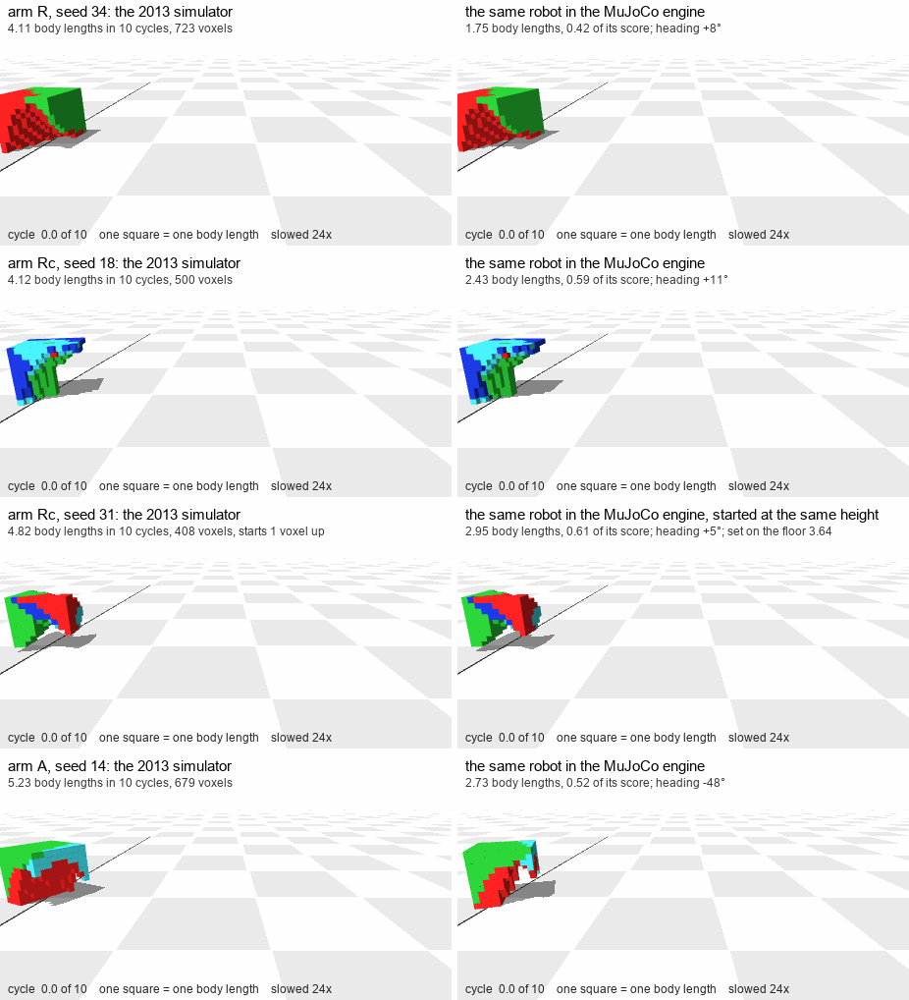
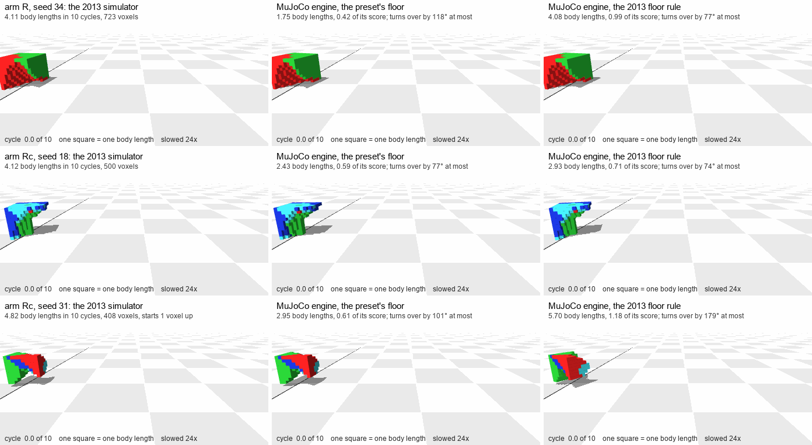

# Outcomes of the campaign

Reports of `paper/analysis/analyse_arm.py`, computed as fixed in [PROTOCOL.md](../PROTOCOL.md) and copied here from `results/analysis/` (which is kept out of git) once an arm is complete.

## Arm R: the original 2013 experiment, re-executed

35 runs of the authors' search program and simulator, built here from their source: seeds 1 to 35, 1000 generations, no cost. Started 21 November 2026 at 23:27, complete on 22 November at 21:40. Analysed once, on 22 November at 22:23, with the code of commit 27e89df. The report says "dirty" because the tracked simulator log `MUJOCO_LOG.TXT` differed from the commit; nothing else did.

**Arm R reproduces the deposited 2013 runs, by the criterion fixed before the campaign.**

| Champion score, best so far | Arm R, median (quartiles) | Deposited 2013, median (quartiles) | Ratio of medians (95% interval) | A12 (95% interval) | p (Mann-Whitney) |
|---|---|---|---|---|---|
| Generation 1000, primary | 4.41 (4.27–4.71) | 4.39 (4.20–5.07) | 1.00 (0.94–1.05) | 0.48 (0.34–0.62) | 0.75 |
| Generation 300 | 3.91 (3.49–4.19) | 3.70 (3.52–4.11) | 1.06 (0.96–1.10) | 0.54 (0.40–0.67) | 0.60 |
| Generation 100 | 3.31 (2.81–3.78) | 3.26 (2.75–3.59) | 1.02 (0.90–1.17) | 0.52 (0.38–0.65) | 0.81 |

- **Primary outcome.** Ratio of medians 1.004, 95% interval 0.942 to 1.048, inside 0.90 to 1.10. A perfect reproduction would have met this criterion in 66% of cases (PROTOCOL.md, section 9.2).
- **Holm.** Over the five primary comparisons it is final only when all arms are in. For this comparison it will lie between 0.75 and 1.

The body of each run's final champion:

| Measure | Arm R, median (quartiles) | Deposited 2013, median (quartiles) | A12 (95% interval) | p | p (Holm, five measures) |
|---|---|---|---|---|---|
| Voxels | 675 (598–704) | 652 (594–698) | 0.52 (0.38–0.66) | 0.77 | 1.00 |
| Footprint, cells | 24 (16–30) | 26 (14–40) | 0.44 (0.30–0.58) | 0.39 | 1.00 |
| Fill of the bounding box | 0.68 (0.60–0.70) | 0.65 (0.59–0.70) | 0.52 (0.38–0.66) | 0.81 | 1.00 |
| Muscle fraction | 0.99 (0.95–1.00) | 1.00 (0.96–1.00) | 0.45 (0.32–0.58) | 0.46 | 1.00 |
| Two or more separate feet | 3 of 35 | 1 of 35 | | 0.61 (Fisher) | 1.00 |

Checks made on the result:

| Check | Result |
|---|---|
| The primary numbers recomputed from the raw curve files, without the analysis code | Medians 4.4103 and 4.3931, ratio 1.0039 |
| The launcher's closing summary, which resampled the runs in another order | The same interval, 0.942 to 1.048 |
| The first ten generations of seeds 1 to 12 against the pilot of 21 November | Identical in all 12 |
| Each champion's fitness in its file name against the last row of its run's curve | Agree in all 35 |
| Audit: each champion re-simulated in the 2013 simulator (`arm_R_champion_audit.csv`) | All 35 reproduce their recorded score, to the six digits the simulator prints |

The arm was launched once and no run was interrupted, so no seed was started more than once.

The transfer scores of this arm's champions, a secondary outcome of the protocol, are in the section "Transfer" below.

## Arm Rc: the original 2013 experiment with the actuated-voxel cost, re-executed

35 runs of the same two programs with the cost condition of 2013 (the search program's `-P 2`): seeds 1 to 35, 1000 generations. Started 22 November 2026 at 23:19; cut short on 23 November at 08:46, when three runs had finished; its 32 unfinished seeds started again from the beginning at 09:00; complete at 23:20 (the slowest run took 14.3 hours). Analysed once, on 24 November at 10:08, with the code of commit aa83d02 (again "dirty" only for `MUJOCO_LOG.TXT`).

**Arm Rc is not distinguishable from the deposited 2013 cost runs. Reproduction within 10% is not shown, and could not have been:** in this condition a perfect reproduction meets the criterion in 0% of cases (PROTOCOL.md, section 9.2, recorded before any arm was analysed).

| Champion's original score, best so far | Arm Rc, median (quartiles) | Deposited 2013, median (quartiles) | Ratio of medians (95% interval) | A12 (95% interval) | p (Mann-Whitney) |
|---|---|---|---|---|---|
| Generation 1000, primary | 3.57 (3.30–4.13) | 3.41 (3.23–4.08) | 1.05 (0.88–1.12) | 0.54 (0.40–0.68) | 0.55 |
| Generation 300 | 3.06 (2.73–3.33) | 3.25 (2.77–3.60) | 0.94 (0.88–1.05) | 0.43 (0.30–0.57) | 0.32 |
| Generation 100 | 2.60 (2.23–2.85) | 2.65 (2.30–2.98) | 0.98 (0.85–1.10) | 0.47 (0.33–0.60) | 0.66 |

- **Primary outcome.** Ratio of medians 1.046, 95% interval 0.876 to 1.119. It contains 1 and is not inside 0.90 to 1.10.
- **Holm.** For this comparison it will lie between 0.55 and 1.

The body of each run's final champion:

| Measure | Arm Rc, median (quartiles) | Deposited 2013, median (quartiles) | A12 (95% interval) | p | p (Holm, five measures) |
|---|---|---|---|---|---|
| Voxels | 363 (296–452) | 362 (292–432) | 0.50 (0.37–0.64) | 0.97 | 1.00 |
| Footprint, cells | 7 (4–16) | 5 (3–14) | 0.56 (0.42–0.70) | 0.38 | 1.00 |
| Fill of the bounding box | 0.46 (0.41–0.50) | 0.44 (0.36–0.50) | 0.56 (0.42–0.70) | 0.38 | 1.00 |
| Muscle fraction | 0.62 (0.46–0.94) | 0.60 (0.51–0.86) | 0.51 (0.38–0.65) | 0.85 | 1.00 |
| Two or more separate feet | 1 of 35 | 0 of 35 | | 1.00 (Fisher) | 1.00 |

The cost changes the bodies the way it did in 2013: about half the voxels of the no-cost champions (363 against 675 in arm R) and less muscle (0.62 against 0.99).

Checks made on the result:

| Check | Result |
|---|---|
| The primary numbers recomputed from the raw curve files, without the analysis code | Medians 3.5692 and 3.4124, ratio 1.0459 |
| **Each of the 32 interrupted attempts against the run that replaced it** | Identical in every generation the attempt had reached (395 to 934 generations): the restart repeated the lost run, as the protocol assumes |
| The first ten generations of seeds 3 and 5 against the cost trial of 22 November | Identical |
| Each champion's fitness in its file name against the last row of its run's curve | Agree in all 35; the cost lowered the fitness of all 35 |
| Audit: each champion re-simulated in the 2013 simulator (`arm_Rc_champion_audit.csv`) | All 35 reproduce their recorded original score, to the six digits the simulator prints |

32 of this arm's 35 seeds were started twice (the three that had finished were kept). The unfinished attempts are kept on the WSL side in `runs/_interrupted/`.

The transfer scores of this arm's champions are in the section "Transfer" below.

## What the champions do: videos

Made on 24 November 2026 as a check that the scores describe real locomotion. `paper/analysis/render_champions.py` simulates each robot again in a copy of the 2013 simulator that also records where every voxel is, and draws the frames. For each arm: the champion with the median score and the champion with the best score, below the 2013 champions chosen by the same rule. A robot is 1 cm long and an evaluation lasts a quarter of a second, so the motion is slowed 24 times. The floor's squares are one body length wide, the unit of the score. Red and green are the two muscle types, light blue is soft passive tissue, dark blue stiff.

**Arm R, no cost**

**Arm Rc, actuated-voxel cost**

What the frames and the numbers recorded with them (`videos/*.json`) show:

- **The frames are the scored simulation.** For all eight robots the recording copy of the simulator reports the same distance as the campaign's simulator, and the first and last frame give that distance again. The four champions of this project's runs repeat their recorded scores to the last digit.
- **It is locomotion, not an accident.** After a start-up of one or two cycles every robot gains a steady amount in each cycle: between 0.30 and 0.69 body lengths depending on the robot, and nearly the same from cycle to cycle for a given robot (for example 0.49 to 0.52, or 0.59 to 0.69). No voxel flies off, every number is finite, and the bodies stay on the ground: their centres stay between 3 and 7 voxels high and nothing rises above 12.
- **The bodies are what the statistics say.** Without a cost: compact blocks of 510 to 760 voxels, mostly or entirely muscle, that rock and shuffle forward. With the cost: 330 to 410 voxels, with passive tissue. The re-runs look like the originals in both conditions.
- **Something to know about the 2013 floor.** In this simulator the voxels that touch the floor sink into it: the lowest point of each of the eight bodies reaches 0.64 to 0.81 of a voxel below the floor's surface during its run, in the 2013 robots and the re-runs alike. The floor is a spring on each voxel's centre and the bodies are heavy. That is the original physics, not a fault of the reproduction; it matters when this simulator is compared with another.
- **Single 2013 robots do not all score today what they scored in 2013.** The best deposited no-cost champion was recorded at 5.95 and scores 4.90 in today's build of the same source; the median one 4.39 and 4.22. This is the compiler difference documented for the replay of all deposited robots (reference README, section 1): typical robots agree to a fraction of a percent, about one in five differs by more than 5%. The captions give both numbers. Arm R and arm Rc compare distributions of whole runs, which is why they are the test of the experiment and single robots are not.

| File | Content |
|---|---|
| `videos/arm_R_champions.gif`, `videos/arm_Rc_champions.gif` | The animations |
| `videos/*.webp` | The same in full colour |
| `videos/*.png` | Five moments of each, as a still picture |
| `videos/*.json` | The checks made on each robot shown |

## Transfer: the champions of arms R and Rc in the MuJoCo engine

A secondary outcome of the protocol: every final champion scored in the simulator it was not evolved in. Here the 35 champions of arm R, the 35 of arm Rc and the 35 deposited champions of each condition, each scored once in this project's MuJoCo engine with the settings of `--preset cheney2013`, over the full 0.25 s. How it is computed was fixed in PROTOCOL.md, section 9.4, before any champion of an arm was scored. Scored on 24 November 2026 with `paper/analysis/transfer_scores.py` as committed in 84c2fda. The report names commit 71f6ea4, made while the run was under way; it added the video tool and did not touch the scoring code. It says "dirty" for the tracked simulator log and a documentation file. The engine was that of the code tag `campaign-v2`. 189 evaluations, four hours of processor time.

The transfer ratio of a champion is its score in the MuJoCo engine over its score in this campaign's build of the 2013 simulator: how much of its score it keeps.

**Champions evolved in the 2013 simulator lose a large part of their score in the MuJoCo engine, and the two simulators do not agree on which champions are the better ones.**

Every body set on the floor, which is the preset as it is and the outcome the protocol names:

| Champions | Score in the 2013 simulator, median (quartiles) | Score in the MuJoCo engine | Transfer ratio | 95% interval of its median | Rank agreement between the simulators (95% interval) | Keep all or more |
|---|---|---|---|---|---|---|
| Arm R | 4.41 (4.27–4.71) | 1.90 (1.45–3.47) | 0.43 (0.33–0.75) | 0.37–0.64 | +0.26 (−0.10 to +0.57) | 6 of 35 |
| Deposited 2013, no cost | 4.32 (4.12–4.66) | 3.23 (1.78–4.37) | 0.75 (0.51–0.91) | 0.59–0.90 | +0.33 (+0.02 to +0.58) | 8 of 35 |
| Arm Rc | 3.44 (3.29–4.13) | 2.48 (1.62–3.46) | 0.67 (0.46–0.92) | 0.54–0.81 | −0.02 (−0.33 to +0.31) | 7 of 35 |
| Deposited 2013, actuated cost | 3.34 (3.19–3.88) | 2.58 (1.52–3.71) | 0.85 (0.51–1.12) | 0.55–1.06 | −0.07 (−0.42 to +0.29) | 12 of 35 |

| On the transfer ratio | Arm, median | Deposited, median | A12 (95% interval) | p (Mann-Whitney, not corrected) |
|---|---|---|---|---|
| Arm R against the deposited no-cost champions | 0.43 | 0.75 | 0.37 (0.24–0.50) | 0.057 |
| Arm Rc against the deposited cost champions | 0.67 | 0.85 | 0.42 (0.29–0.56) | 0.25 |

What the numbers say:

- **Every set loses.** The median champion keeps between 0.43 and 0.85 of its score. No simulation blew up.
- **Single robots go every way.** Ratios run from 0.07 to 1.62. In each set between 6 and 12 champions score as much or more in the MuJoCo engine, and between 8 and 20 keep less than half.
- **No agreement on rank.** A champion's score in one simulator says little about its score in the other: the rank agreement is +0.26 and +0.33 without the cost, and none with it. For comparison, two builds of the 2013 simulator itself agree at +0.88 and +0.91 on the same deposited champions (reference README, section 1).
- **Re-run champions against 2013 champions.** Arm R's champions tend to keep less than the deposited no-cost ones (0.43 against 0.75, p = 0.057, not corrected). In the cost condition the difference is smaller and far from clear (p = 0.25). These comparisons are descriptive and carry no criterion; the data do not settle whether the tendency is real. Arm A will add 35 more champions evolved in this campaign's build.
- **This repeats the diagnostic of 18 November and extends it to the re-runs.** Against the scores recorded in 2013 the deposited champions keep 0.68 (no cost) and 0.77 (cost), the figures measured then.

### Where a body starts

Found while preparing this outcome, and recorded in the protocol before any arm champion was scored. The 2013 simulator starts a body where it is in the workspace. A body that does not touch the bottom starts in the air and falls first, and the score, a distance in three dimensions, includes the drop. Checked in the recording copy of the simulator on the deposited cost champion of run_114: it starts 3 voxels up, falls for about 15 ms, and the simulator reports the three-dimensional distance (2.397, where the horizontal distance alone is 2.344). The MuJoCo engine sets every body on the floor before it starts.

How many champions this concerns: none of the deposited no-cost champions, 1 of arm R's, 12 of the deposited cost champions, 16 of arm Rc's (1 to 3 layers up). Each of them was scored a second time in the MuJoCo engine, started at its height in the workspace:

| Champions | Off the bottom | Transfer ratio, set on the floor | Transfer ratio, started where they are | 95% interval of its median | Rank agreement |
|---|---|---|---|---|---|
| Arm R | 1 of 35 | 0.43 (0.33–0.75) | 0.43 (0.33–0.75) | 0.37–0.64 | +0.26 (−0.09 to +0.57) |
| Deposited 2013, no cost | 0 of 35 | 0.75 (0.51–0.91) | the same | | |
| Arm Rc | 16 of 35 | 0.67 (0.46–0.92) | 0.61 (0.42–1.05) | 0.46–0.94 | −0.10 (−0.42 to +0.23) |
| Deposited 2013, actuated cost | 12 of 35 | 0.85 (0.51–1.12) | 0.88 (0.54–1.12) | 0.62–0.99 | +0.12 (−0.25 to +0.46) |

- For the sets it changes little: the medians move by 0.05 and 0.03, and arm Rc against the deposit stays as unclear as before (A12 0.42, p = 0.23).
- For single robots it matters a great deal: started at its height, a body off the bottom scores higher in half the cases and lower in the other half (8 of 16 in arm Rc, 6 of 12 in the deposit). The score changes by more than half a body length for 15 of the 29, and by as much as 2.8 (deposited run_125: 1.25 on the floor, 4.01 from one voxel up).
- **It is a difference between the preset and the 2013 experiment that was not known before**, and it concerns the cost condition most. Whether arm D should start its bodies the way the 2013 simulator does was open when this was written (PROTOCOL.md, section 9.4, point 9). It was settled on 25 November: arm D starts them where they are in the workspace, as the 2013 simulator does (PROTOCOL.md, section 9.5; PLAN.md, decision 11).

### Checks

| Check | Result |
|---|---|
| The scoring is the search's own evaluation under the preset: the search's command line run under the preset, then every robot of its final population scored by this script | The same score for every robot (`tests/test_transfer_scores.py`) |
| The deposited champions against the diagnostic of 18 November, which scored the same robots with other code | Identical to the last digit: 35 of 35 without the cost, 32 of 32 with it (for 3 cost runs the diagnostic had taken another robot as champion, the one with the highest original score) |
| The score against the distance the centre of mass moved, read separately | Agree in all 169 evaluations at the engine's time step |
| Simulations that blew up, or that the engine could not build | None |
| The body in the two simulators, for the three robots of the video | The same voxels of the same materials in the same places, and the same starting height |
| **A quarter of the time step**, on the first five champions of each set (named in the protocol beforehand) | The score changes by 3.3% in the median, by more than 10% for 5 of the 20, and by 51% for one (arm R, seed 2: 0.88 becomes 1.32). No direction: the median change is +0.3% |

The last check limits what a single number means: the MuJoCo score of one robot can depend on the time step by tens of percent. The five that change by more than 10% all score below 3.2 in the MuJoCo engine; the five checked champions that score above 4.5 change by 0.2% to 7.5%. The medians of the sets rest on 35 robots each and the check gives no sign of a bias, but it covered 20 robots, not all. The same goes for the starting height above: a robot whose score moves by a body length when it is started one voxel higher is not a robot with one well-defined score in this engine.

Also recorded with every evaluation: the lowest voxel sinks 0.15 to 0.18 of a voxel below the floor in the median, part of which is a contracted muscle voxel being smaller, and the vertical part of the distance moved is 5% to 7% of the score.

### What it looks like

`paper/analysis/render_transfer.py` shows the same robot in both simulators, left the 2013 simulator, right the MuJoCo engine. The robots are chosen by a rule, not by eye: for each arm the champion with the median transfer ratio among those that touch the bottom of the workspace, and for arm Rc also the one with the median ratio among those that do not, started at its height. The right-hand frames come from the evaluation that was scored (its score is the reported one to the last digit).

| Robot | 2013 simulator | MuJoCo engine | Gain in distance per cycle, 2013 | Gain per cycle, MuJoCo | The body turns over by at most |
|---|---|---|---|---|---|
| Arm R, seed 34 | 4.11 | 1.75 (0.42) | 0.45 to 0.48 from the fourth cycle on | 0.57 and 0.56 in cycles 3 and 4, then falling, −0.46 and −0.34 in the last two | 50° and 118° |
| Arm Rc, seed 18 | 4.12 | 2.43 (0.59) | 0.46 to 0.53 in cycles 3 to 8 | 0.60 and 0.65 in cycles 2 and 3, then 0.02 to 0.30 | 59° and 77° |
| Arm Rc, seed 31, starts 1 voxel up | 4.82 | 2.95 (0.61); 3.64 when set on the floor | 0.52 to 0.57 from the fourth cycle on | uneven, 0.12 to 0.50 | 65° and 101° |

- **The start is alike, the rest is not.** In the MuJoCo engine all three robots set off in nearly the same direction as in the 2013 simulator (5° to 11° apart) and are about as fast, or faster, for the first two to four cycles. Then they tip further over than they ever do in the 2013 simulator and the gait breaks down; the first one moves back towards its start in the last two cycles.
- **In the 2013 simulator the same robots keep a steady gait** for most or all of the run, gaining nearly the same distance in each cycle (the second one slows in its last two cycles).
- **The floors differ.** In the 2013 simulator the lowest point of these bodies is 0.81 to 0.86 of a voxel below the floor's surface; in the MuJoCo engine 0.10 to 0.15. A body standing most of a voxel deep in the floor may be held upright by it. That the 2013 gaits lean on this is a reading that fits what is seen here; these runs do not test it. The test followed the next day and is reported below.

Three robots are three robots. They were picked as the middle of their sets, so they show a typical loss, not the range.

### Tested on 25 November: the loss is the floor

Exploratory, not an outcome of the protocol; the full account is in [`../diagnostics_2026-11-25/README.md`](../diagnostics_2026-11-25/README.md).

The 2013 simulator's floor, read from its source, is a spring on the centre of each contact voxel (`E × size / 2`, 5000 N/m) with a friction rule that stops a slow voxel dead and holds it. Under a champion's weight that spring gives 0.14 to 0.29 of a voxel at rest; the preset's floor gives practically nothing. The rule was emulated on the loaded engine, without changing the engine's code, checked on blocks (a block rests and lands where the 2013 simulator puts it, to four digits at rest) and on the 12 pilot robots, and then all 140 champions were scored under it.

| Champions | Share of the score kept on the preset's floor | Under the 2013 floor rule, started where they are | Better under the rule | Rank agreement with the 2013 scores |
|---|---|---|---|---|
| Arm R | 0.43 (0.33–0.75) | 1.02 (0.77–1.27) | 29 of 35 | +0.26 becomes +0.36 |
| Deposited 2013, no cost | 0.75 (0.51–0.91) | 1.16 (0.76–1.33) | 28 of 35 | +0.33 becomes +0.59 |
| Arm Rc | 0.67 (0.46–0.92) | 1.07 (0.84–1.25) | 29 of 35 | −0.02 becomes +0.61 |
| Deposited 2013, actuated cost | 0.85 (0.51–1.12) | 1.15 (0.85–1.33) | 25 of 35 | −0.07 becomes +0.58 |

- **Under the 2013 floor rule the champions keep their score** (p between 0.000002 and 0.004 by set, per champion against the preset's floor). They stand as deep in the floor as in the 2013 simulator (0.74 to 0.83 of a voxel against 0.68 to 0.79) and tip over less (52 of 140 against 67).
- **It is the rule, not softness as such**: MuJoCo's own contact made as soft at rest, and its default contact, do not help.
- **The engine is still not the 2013 simulator robot by robot.** Under the rule the typical champion is off by about a quarter, the engine tends to give somewhat more than the 2013 simulator (2% to 16% in the median), and 52 champions still tip over where 5 do in the 2013 simulator.
- **The rule was an emulation written for this test.** The same day it was built into the engine as an option, together with the 2013 start, and arm D is to run with both (`--preset cheney2013-floor`; PROTOCOL.md, section 9.5). The engine's own rule gives the same scores as the emulation, to the last digit.

The same three robots as above: left the 2013 simulator, middle the engine on the preset's floor, right the engine under the 2013 floor rule. The first is restored (4.08 against 4.11), the second helped a little (2.93 against 4.12), the third overshoots by rolling over (5.70 against 4.82).

| File | Content |
|---|---|
| `transfer.txt`, `transfer.json` | The report as printed and as data, with every champion |
| `transfer_champions.csv` | One row per champion: both scores, both ratios, the distance moved along each axis, how deep it sank, the time step, and the score at a quarter of the time step where it was checked |
| `videos/transfer_champions.gif`, `.webp`, `.png`, `.json` | The animation, the same in full colour, five moments as a still picture, and the checks and measurements of the three robots |

## Files

| File | Content |
|---|---|
| `arm_R.txt`, `arm_Rc.txt` | The reports as printed, with every seed |
| `arm_R.json`, `arm_Rc.json` | The same as data: every number, every seed's scores and champion |
| `arm_R_champion_audit.csv`, `arm_Rc_champion_audit.csv` | The audits: recorded score and re-simulated distance of each champion |
| `transfer.txt`, `transfer.json`, `transfer_champions.csv` | The transfer outcome (section above) |
